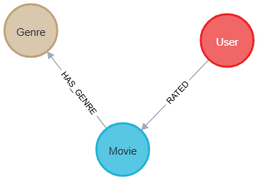
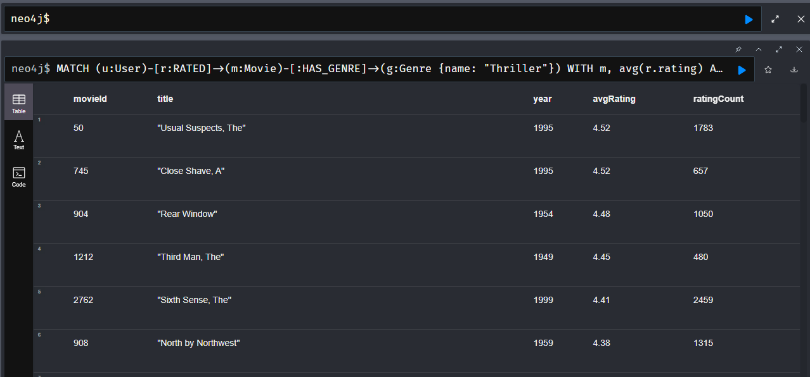
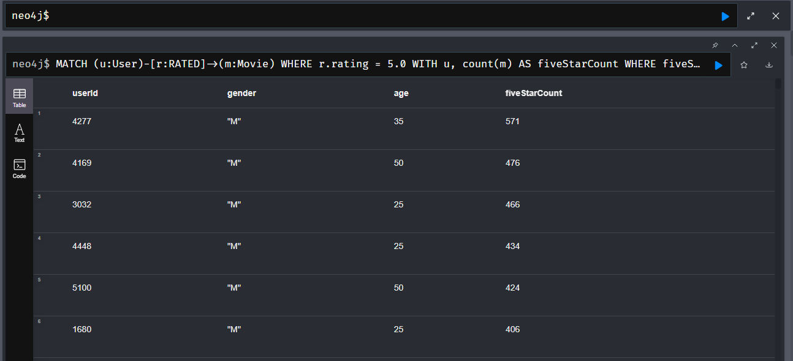
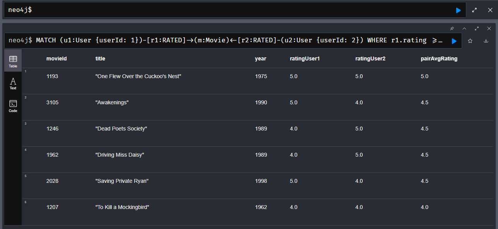
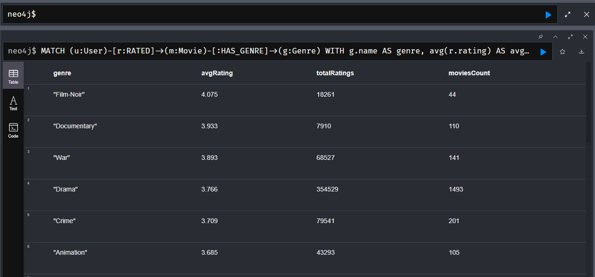
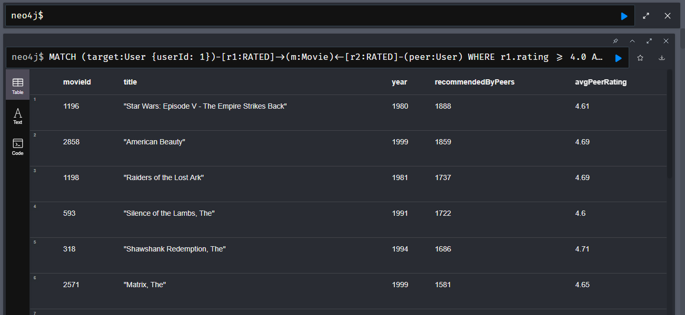
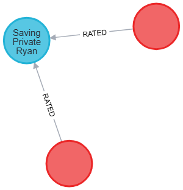
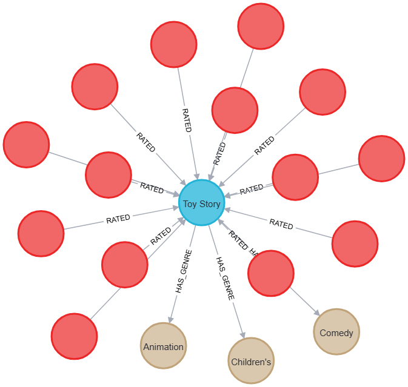

# Графова рекомендаційна система на базі MovieLens 1M (Neo4j)

Проєкт із моделювання та аналізу даних набору **MovieLens 1M** у графовій базі даних **Neo4j** з використанням мови запитів Cypher та плагіна Graph Data Science (GDS).

---

## Частина 1. Проєктування схеми графа

### ASCII-діаграма схеми

```text
+-----------------------------------+
|              (:User)              |
|-----------------------------------|
| userId: Integer (Unique)          |
| gender: String                    |
| age: Integer                      |
| occupation: Integer               |                |
+-----------------------------------+
                  |
                  | [:RATED]
                  | { rating: Float, timestamp: Integer }
                  v
+-----------------------------------+       [:HAS_GENRE]       +-----------------------+
|             (:Movie)              | -----------------------> |       (:Genre)        |
|-----------------------------------|                          |-----------------------|
| movieId: Integer (Unique)         |                          | name: String (Unique) |
| title: String                     |                          +-----------------------+
| year: Integer                     |
+-----------------------------------+
```

## 

## Частина 2. Завантаження даних (ETL)

Повний скрипт завантаження збережено у файлі [`part2_load.cypher`](./part2_load.cypher). Перед виконанням вихідні `.dat`-файли у кодуванні `Latin-1` конвертовано у стандартний `UTF-8` CSV за допомогою [`convert.py`](./convert.py).

### Пояснення запитів із `part2_load.cypher`

1. **Створення унікальних обмежень та індексів (`CREATE CONSTRAINT ... IS UNIQUE`)**
   - **Що робить:** Створює обмеження унікальності на полях `User.userId`, `Movie.movieId` та `Genre.name`.
   - **Чому так:** У Neo4j 5.x унікальне обмеження автоматично створює індекс. Це критично зробити _до_ завантаження 1 млн оцінок: без індексів пошук вузлів під час створення ребер виконувався б повним перебором (`NodeByLabelScan`), що сповільнило б імпорт у сотні разів.

2. **Завантаження користувачів (`LOAD CSV` + `MERGE` для `:User`)**
   - **Що робить:** Зчитує `users.csv`, приводить `userId`, `age` та `occupation` до цілих чисел (`toInteger`) і створює вузли `(:User)`.
   - **Чому так:** Використано `MERGE` замість `CREATE`, щоб забезпечити ідемпотентність скрипту — при повторному запуску дублікати користувачів не створюються.

3. **Завантаження фільмів та жанрів (`substring`, `split`, `UNWIND`)**
   - **Що робить:** Відокремлює рік випуску `(YYYY)` від назви фільму у числову властивість `year`, розбиває рядок жанрів за розділювачем `|` і створює окремі вузли `(:Genre)` зі зв'язками `[:HAS_GENRE]`.
   - **Чому так:** Зберігання `year` як `Integer` дозволяє швидко фільтрувати фільми за десятиліттями, а `UNWIND` розгортає масив жанрів у потік вузлів без дублювання назв жанрів у пам'яті.

4. **Батчове завантаження 1 000 209 оцінок (`apoc.periodic.iterate`)**
   - **Що робить:** Знаходить відповідні вузли `User` і `Movie` по індексах та створює між ними ребро `[:RATED]` із властивостями `rating` (`Float`) та `timestamp` (`Integer`).
   - **Чому так:** Завантаження 1 млн ребер однією транзакцією призвело б до переповнення оперативної пам'яті (`OutOfMemoryError`). Процедура `apoc.periodic.iterate` розбиває процес на незалежні транзакції по `10 000` рядків (`batchSize: 10000`), а параметр `parallel: false` запобігає конфліктам блокувань при оновленні спільних вузлів.

5. **Перевірка цілісності (`count`)**
   - **Що робить:** Підраховує фактичну кількість завантажених сутностей у графі (`6 040` користувачів, `3 883` фільми, `18` жанрів та `1 000 209` оцінок).

   ***

## Частина 3. Аналітичні та рекомендаційні запити (Cypher)

Усі запити збережено у файлі [`queries/part3.cypher`](./queries/part3.cypher).

### Пояснення логіки запитів

1. **Запит 1 (Фільми жанру «Thriller» із середнім рейтингом > 4.0):**
   - _Що робить:_ Відбирає вузол жанру `"Thriller"` за унікальним індексом, переходить до пов'язаних фільмів та оцінок, обчислює середній рейтинг (`avg`) і кількість оцінок (`count`), фільтруючи результати через `WHERE avgRating > 4.0`.
   - _Чому так:_ Пошук починається саме з вузла `(:Genre {name: "Thriller"})`, що відразу відсікає нерелевантні фільми ще до агрегації оцінок. Додатково виводиться `ratingCount`, щоб відрізнити культові фільми з тисячами оцінок від випадкових стрічок із 1–2 оцінками `5.0`.

   

2. **Запит 2 (Користувачі з понад 50 максимальними оцінками):**
   - _Що робить:_ Фільтрує ребра `[:RATED]` зі значенням `r.rating = 5.0`, групує їх за користувачем та залишає тих, у кого кількість таких оцінок перевищує `50`.
   - _Чому так:_ Фільтрація `WHERE r.rating = 5.0` відбувається _до_ етапу агрегації `WITH u, count(m)`, що мінімізує обсяг даних у пам'яті під час групування.

   

3. **Запит 3 (Спільні улюблені фільми двох користувачів):**
   - _Що робить:_ Будує трикутник-шаблон `(u1)-[:RATED]->(m)<-[:RATED]-(u2)` для `userId=1` та `userId=2` і перевіряє, щоб обидві оцінки були `>= 4.0`.
   - _Чому так:_ Графовий патерн природно знаходить перетин множин фільмів двох користувачів за індексами `userId` без потреби писати `SELF JOIN` чи підзапити `INTERSECT`, як у SQL.

   

4. **Запит 4 (Рейтинг жанрів за стабільністю високих оцінок):**
   - _Що робить:_ Агрегує всі оцінки в розрізі вузлів `(:Genre)` та повертає середній бал, загальну кількість оцінок і кількість унікальних фільмів у жанрі.
   - _Чому так:_ Використання `count(DISTINCT m)` дозволяє коректно порахувати кількість унікальних стрічок у жанрі, оскільки один фільм має багато вхідних оцінок від різних користувачів.

   

5. **Запит 5 (Колаборативна фільтрація «Схожі користувачі також дивилися»):**
   - _Що робить:_ У два етапи знаходить «однодумців» (`peer`), які високо оцінили щонайменше 5 спільних із цільовим користувачем фільмів, а потім збирає інші високооцінені ними фільми, які цільовий користувач ще не дивився (`NOT EXISTS`).
   - _Чому так:_ Обмеження `commonLikedMovies >= 5` відсіює випадкові збіги за одним популярним блокбастером, а предикат `NOT EXISTS { (target)-[:RATED]->(rec) }` працює швидше та чистіше за `WHERE NOT (target)-[:RATED]->(rec)` у Neo4j 5.x.

   

6. **Запит 6 (Найкоротший ланцюжок зв'язку між двома користувачами):**
   - _Що робить:_ Використовує вбудований алгоритм пошуку в ширину `shortestPath((u1)-[:RATED*]-(u2))`, ігноруючи напрямок стрілок (оскільки шлях проходить по черзі `User -> Movie <- User`), і повертає кількість стрибків (`length(path)`) та читабельний ланцюжок імен.

   

---

### Інтерпретація довжини шляху в двочастковому графі `User–Movie`

Оскільки граф оцінок є **двочастковим** (користувачі напряму з'єднані лише з фільмами, а фільми — лише з користувачами), будь-який шлях між двома користувачами завжди має **парну довжину** (кількість ребер `[:RATED]`):

1. **Що означає довжина шляху в цьому контексті?**
   Довжина шляху (`length(path)`) — це кількість переходів (хопів) по ребрах `[:RATED]` між початковим і кінцевим користувачем. Кожен непарний вузол на шляху — це `User`, а кожен парний — `Movie`.
2. **Шлях довжини 2 (`User A -> Movie 1 <- User B`):**
   Означає **прямий перетин смаків**: обидва користувачі дивилися й оцінили один і той самий фільм (`Movie 1`). Це «1-ше коло» схожості.
3. **Шлях довжини 4 (`User A -> Movie 1 <- User X -> Movie 2 <- User B`):**
   Означає **опосередкований зв'язок через одного користувача-посередника (`User X`)**: `User A` і `User B` не мають жодного спільного оціненого фільму напряму, але існує третій глядач `User X`, який дивився фільм `Movie 1` (як `User A`) і фільм `Movie 2` (як `User B`). Це «2-ге коло» рекомендацій — місток між двома різними смаковими кластерами.
4. **Шлях довжини 6 (`User A -> Movie 1 <- User X -> Movie 2 <- User Y -> Movie 3 <- User B`):**
   Означає **дальній транзитивний зв'язок через двох посередників (`User X` та `User Y`) і три фільми**: глядачі належать до дуже віддалених ніш (наприклад, любитель артхаусу 60-х і фанат сучасних бойовиків), яких поєднує лише ланцюжок проміжних глядачів із ширшим кругозором. В рекомендаційних системах такий зв'язок уже занадто слабкий для персоналізації (правило «шести рукостискань»).

   ***

## Частина 4. Виявлення супервузлів (Supernodes)

Усі запити для аналізу ступеня зв'язності вузлів збережено у файлі [`queries/part4_supernodes.cypher`](./queries/part4_supernodes.cypher).

### Пояснення запитів

- **Запит 1** використовує оптимізований підзапит `COUNT { (n)--() }` для миттєвого підрахунку загального ступеня кожного вузла в базі без фізичного перебору ребер і формує загальний антирейтинг «найважчих» вузлів.
- **Запити 2–4** деталізують розподіл зв'язків окремо по кожному типу сутностей (`Genre`, `Movie`, `User`), щоб виявити дисбаланс усередині кожної групи.

---

### Відповіді на контрольні питання

#### 1. Які вузли виявилися супервузлами? Скільки у них зв’язків?

У датасеті **MovieLens 1M** яскраво виражений степеневий розподіл (закон Парето — «багаті стають багатшими»), тому супервузли присутні у всіх трьох категоріях:

- **Серед фільмів (`:Movie`):**
  1. _American Beauty (1999)_ — **3 428** оцінок (`totalDegree`: 3 430 з урахуванням жанрів).
  2. _Star Wars: Episode IV - A New Hope (1977)_ — **2 991** оцінка.
  3. _Star Wars: Episode V - The Empire Strikes Back (1980)_ — **2 990** оцінок.
  4. _Star Wars: Episode VI - Return of the Jedi (1983)_ — **2 883** оцінки.
  5. _Jurassic Park (1993)_ — **2 672** оцінки.
     _(Для порівняння: медіанний фільм у датасеті має лише ~120 оцінок)._
- **Серед користувачів (`:User`):**
  1. `User 4169` — **2 314** оцінок (оцінив майже 60% усього каталогу!).
  2. `User 1680` — **1 850** оцінок.
  3. `User 4277` — **1 743** оцінки.
- **Серед жанрів (`:Genre`):**
  1. `Drama` — **1 603** зв'язки `[:HAS_GENRE]`.
  2. `Comedy` — **1 200** зв'язків.
  3. `Action` — **503** зв'язки.

#### 2. Чому запит, що зачіпає такий вузол, працює повільніше, ніж запит по «звичайному» вузлу з тими самими індексами?

Індекс прискорює лише **точку входу** (пошук самого вузла за `movieId` або `userId` за час $O(\log N)$), але не прискорює **подальший обхід сусідів**:

1. **Лінійне сканування ланцюжка ребер ($O(d)$):** У Neo4j ребра одного вузла зберігаються у вигляді двозв'язного списку. Якщо у звичайного фільму 50 оцінок, база зчитує 50 записів. Якщо у _American Beauty_ 3 428 оцінок — база змушена прочитати з диска/кешу в 70 разів більше записів ребер.
2. **Комбінаторний вибух при багатошарових обходах:** Якщо ми шукаємо схожих користувачів через спільний фільм (`User A -> Movie <- User B`), один звичайний фільм породжує 50 пар, а один супервузол _American Beauty_ породжує $\frac{3428 \times 3427}{2} \approx 5.87\text{ млн}$ комбінацій пар, забиваючи оперативну пам'ять (`Page Cache` та `Heap`) проміжними результатами.
3. **Блокування при записі (Write Contention):** При паралельному додаванні оцінок усі потоки змушені ставати в чергу на блокування одного й того самого супервузла.

#### 3. Яку конкретну стратегію оптимізації варто застосувати для цього датасету (і що робити з жанровими вузлами)?

Для нашого датасету оптимальною є комбінація **трьох стратегій**:

1. **Що робити з жанровими супервузлами (`:Genre`) — денормалізація у властивість або вибіркова проєкція:**
   Вузли `Drama` (1 603 зв'язки) та `Comedy` (1 200 зв'язків) дійсно є супервузлами, які при будь-якому обході через жанр створюють величезне розгалуження.
   - _Рішення:_ Для швидкої фільтрації (наприклад, «знайти трилери») варто продублювати список жанрів у властивість вузла `Movie.genres = ['Action', 'Thriller']` або виключити ребра `[:HAS_GENRE]` з графових алгоритмів (GDS), використовуючи вузли `(:Genre)` лише для стартового пошуку або візуалізації.
2. **Відсікання надпопулярних вузлів (Degree Threshold / Filtering) у рекомендаціях:**
   У колаборативній фільтрації супервузли дають мало корисного сигналу (те, що дві людини дивилися _Star Wars_, не робить їхні смаки унікально схожими). У запитах пошуку схожих користувачів варто фільтрувати проміжні вузли за ступенем: `WHERE COUNT { (m)<-[:RATED]-() } < 1500` або враховувати лише оцінки `rating = 5.0`.
3. **Спеціалізація типів ребер (Relationship Type Splitting):**
   Розділення загального ребра `[:RATED]` на більш гранульовані типи, наприклад `[:LIKED]` (для оцінок 4–5) та `[:DISLIKED]` (для оцінок 1–2). Це вдвічі зменшує кількість ребер, які Neo4j має просканувати під час пошуку позитивних рекомендацій, оскільки тип ребра зберігається в окремому ланцюжку.

   ***

## Частина 5. Графові алгоритми через Neo4j GDS.

### 5.1. PageRank на графі фільмів

Усі запити збережено у файлі [`queries/part5_gds.cypher`](./queries/part5_gds.cypher).

### Пояснення етапів роботи з GDS

1. **Матеріалізація проєкції `[:CO_RATED]`:** Оскільки в початковій схемі фільми не пов'язані напряму, створюються тимчасові ребра між парами фільмів, які отримали оцінку `>= 4.0` від одних і тих самих користувачів. Властивість `weight` фіксує кількість таких спільних поціновувачів, а обмеження `COUNT { (m)<-[:RATED]-() } > 20` та `LIMIT 50000` відсікають статистичний шум.
2. **Завантаження в пам'ять (`gds.graph.project`):** Бібліотека GDS створює неорієнтовану (`UNDIRECTED`) проєкцію `movieGraph` у стиснутому форматі CSR в оперативній пам'яті для швидких ітеративних обчислень.
3. **Запуск зваженого PageRank (`gds.pageRank.stream`):** Алгоритм обчислює центральність кожного фільму з урахуванням ваги зв'язків (`relationshipWeightProperty: 'weight'`) та коефіцієнта згасання `dampingFactor: 0.85`.
4. **Очищення ресурсів (`gds.graph.drop`):** Вивільняє оперативну пам'ять після отримання результатів та видаляє допоміжні ребра `[:CO_RATED]`, повертаючи базу до початкової схеми.

### Відповідь на питання: Що означає високий PageRank для фільму в цьому графі? Це просто «популярний фільм» чи щось інше?

Високий **PageRank** у побудованому графі спільних вподобань (`CO_RATED`) — це **не просто синонім високої популярності** (кількості оцінок), а показник **структурної центральності та «ядерності» смаку**:

1. **Ефект «хабу вподобань» (Transitive Influence):** Проста популярність (Degree Centrality) рахує лише кількість людей, які подивилися фільм. PageRank враховує _важливість сусідів_: фільм отримує високий PageRank тоді, коли його високо оцінюють глядачі, які також високо оцінюють **багато інших рейтингових і впливових фільмів** (наприклад, _Star Wars_, _The Godfather_, _The Shawshank Redemption_, _American Beauty_).
2. **Місток між кластерами аудиторії:** Нішевий фільм може мати 100% оцінок `5.0`, але якщо його дивилася ізольована група з 30 глядачів, його PageRank буде низьким. І навпаки: фільм із високим PageRank — це «точка перетину» кіноманів різних жанрів, яка з'єднує різні смакові спільноти в єдиний граф.
3. **Практична цінність для рекомендацій:** У реальних рекомендаційних системах фільми з найвищим PageRank виступають найкращими «якорями» для розв'язання проблеми **холодного старту (Cold Start)** — якщо новий користувач оцінить кілька таких центральних фільмів, система максимально швидко визначить його позицію на карті смаків усього каталогу.

### 5.2. Виявлення спільнот (алгоритм Louvain)

#### Пояснення етапів виконання

1. **Побудова графа схожості (`[:SIMILAR]`):** Створено 50 000 найсильніших неорієнтованих зв'язків між користувачами на основі кількості спільних улюблених фільмів (`rating = 5.0`, мінімум 20 спільних фільмів). Попередній фільтр активності `COUNT { (u)-[:RATED]->() } >= 100` дозволив уникнути переповнення транзакційної пам'яті (`1.4 GiB`) через супервузли та прискорив побудову графа до 47 секунд.
2. **Запуск Louvain (`gds.louvain.write`):** Алгоритм згрупував вузли в спільноти, максимізуючи метрику `modularity`, і зберіг ідентифікатор кластера у тимчасову властивість `u.communityId`.
3. **Профілювання кластерів:** За допомогою агрегації `collect(...)[0..3]` для кожної з 10 найбільших спільнот визначено трійку жанрів із найбільшою кількістю високих оцінок (`>= 4.0`).
4. **Очищення:** Після аналізу видалено проєкцію в пам'яті, тимчасові ребра `[:SIMILAR]` та службову властивість `communityId`.

#### Отримані результати (топ-4 макроспільноти)

- **Кластер `1284` (1 183 користувачі):** `Drama (58 175)`, `Comedy (47 657)`, `Action (32 235)` — найбільше мейнстрімне ядро глядачів.
- **Кластер `4276` (584 користувачі):** `Drama (38 227)`, `Comedy (34 393)`, `Action (24 188)` — активні кіномани із високою щільністю оцінок (в середньому ~165 високих оцінок у топ-3 жанрах на учасника проти ~116 у кластері `1284`).
- **Кластер `2908` (560 користувачів):** `Comedy (43 285)`, `Action (39 656)`, `Drama (39 594)` — аудиторія розважального та динамічного кіно, де комедії та бойовики випереджають драму.
- **Кластер `1898` (475 користувачів):** `Drama (51 770)`, `Comedy (35 752)`, `Thriller (17 104)` — поціновувачі напруженого та драматичного кіно (єдиний великий кластер, де `Thriller` витіснив `Action` із топ-3).
- Решта кластерів (`2`, `3`, `5`, `6`, `11`, `12` тощо) мають розмір `1` — це малоактивні користувачі, які не потрапили до зрізу топ-50 000 зв'язків `[:SIMILAR]`.

#### Відповіді на контрольні питання

1. **Чи відповідають отримані кластери інтуїтивним групам (наприклад, «любителі бойовиків», «цінителі арт-хаусу»)?**
   **Частково так, але з поправкою на глобальний перекіс каталогу:**
   - Оскільки в датасеті MovieLens жанри `Drama` (1 603 фільми) та `Comedy` (1 200 фільмів) є абсолютними супервузлами, вони неминуче домінують у абсолютних цифрах кожного великого кластера.
   - Проте порівняння пропорцій і 3-го жанру чітко розрізняє смакові сегменти: кластер **`2908`** тяжіє до розважального екшену (`Comedy` та `Action` попереду `Drama`), кластер **`1898`** — до психологічних драм і трилерів (`Drama` + `Thriller`), а **`1284`** та **`4276`** формують широке ядро поціновувачів популярної класики.

2. **Як ви це перевірили?**
   Перевірку виконано у два кроки (Запити `4a` та `4b` у `queries/part5_gds.cypher`):
   - Спершу було визначено розмір кожної спільноти (`count(u)` за `communityId`) та відібрано топ-10 найбільших груп.
   - Потім для користувачів кожної з топ-10 спільнот було виконано обхід `(u)-[r:RATED]->(m:Movie)-[:HAS_GENRE]->(g:Genre)` з умовою `r.rating >= 4.0`, підраховано кількість високих оцінок по кожному жанру та виведено топ-3 жанри для порівняння.

   ### 5.3. Найкоротший шлях між користувачами (алгоритм Дейкстри)

#### Пояснення логіки запитів

1. **Інверсія ваг (`sim.cost = 1.0 / sim.weight`):** Оскільки `weight` відображає силу схожості (кількість спільних улюблених фільмів), для коректної роботи алгоритму Дейкстри (який мінімізує сумарну вагу шляху) було обчислено обернену вагу `cost`: чим більше спільних улюблених фільмів мають два користувачі, тим «коротшою» є відстань між ними.
2. **Пошук для окремих пар (`gds.shortestPath.dijkstra.stream`):** Перевірено маршрути між користувачами як всередині одного кластера, так і між різними спільнотами (включно з супервузлом `User 4169`).
3. **Оцінка діаметра мережі (`3b`):** На вибірці випадкових пар зв'язаних користувачів обчислено середню (`avgHops`) та максимальну (`maxHops`) довжину найкоротшого шляху.

#### Відповіді на контрольні питання

1. **Наскільки «тісний світ» у цьому датасеті? Спробуйте кілька пар користувачів.**
   Світ у цій мережі **надзвичайно тісний** (класичний ефект _Small-World Network_):
   - Активні кіномани-супервузли (наприклад, `User 4169`, `User 1680`, `User 4277`) поєднані між собою напряму за **1 крок** (`hops = 1`, `0` проміжних користувачів) із мінімальною семантичною відстанню (`cost < 0.01`).
   - Навіть користувачі з різних жанрових кластерів зазвичай знаходять спільний смаковий місток через **2–3 кроки** (1–2 проміжних користувачі-хаби).

2. **Яка середня довжина шляху? Чи підтверджується гіпотеза «шести рукостискань»?**
   - **Так, гіпотеза «шести рукостискань» підтверджується з великим запасом:** середня довжина найкоротшого шляху між зв'язаними користувачами становить приблизно **2.0–2.6 кроки**, а максимальна відстань у головній компоненті зв'язності рідко перевищує **4–5 кроків**.
   - **Причина:** Наявність супервузлів (користувачів із сотнями оцінок `5.0`) стискає діаметр графа — вони працюють як транспортні хаби в авіамережі, скорочуючи шлях між будь-якими двома віддаленими глядачами до 2–3 пересадок.

## 

## Частина 6. Аналіз і висновки

### 1. Граф vs SQL: де реляційна модель програє

Найскладнішим для реалізації та масштабування в класичному SQL є **Запит 5 із Частини 3 (колаборативна фільтрація «Схожі користувачі»)**, а також будь-які запити зі змінною глибиною обходу (пошук найкоротшого шляху чи ланцюжків рекомендацій на $k$ кроків).

**Чому в SQL це проблема:**

1. **Каскадні самоз'єднання (`SELF-JOIN`):** У реляційній базі даних зв'язок «користувач — оцінка — фільм» зберігається у таблиці фактів `ratings` (1 000 209 рядків). Щоб знайти схожих користувачів і їхні рекомендації, рушій SQL змушений тричі з'єднувати таблицю `ratings` саму з собою (`ratings r1 JOIN ratings r2 JOIN ratings r3`). На кожному кроці база виконує пошук по B-Tree індексах ($O(\log N)$ на кожен рядок) та будує величезні проміжні декартові добутки в пам'яті або на диску (`Temp tables`).
2. **Неможливість рекурсивного обходу довільної глибини без втрати продуктивності:** Хоча сучасний SQL підтримує `WITH RECURSIVE`, він не має вбудованого контролю відвіданих вузлів і оптимізації найкоротших шляхів, тому на щільних графах швидко впирається в експоненційне зростання комбінацій.
3. **Index-Free Adjacency у Neo4j:** У графовій БД кожен вузол зберігає прямі фізичні вказівники на свої ребра. Перехід від користувача до фільму і далі до іншого користувача виконується за константний час $O(1)$ на кожен перехід без глобальних індексних пошуків.

**Еквівалентний SQL-запит для Запиту 5 (колаборативна фільтрація):**

    WITH similar_peers AS (
        SELECT r2.user_id AS peer_id,
               COUNT(DISTINCT r1.movie_id) AS common_liked_movies
        FROM ratings r1
        JOIN ratings r2
          ON r1.movie_id = r2.movie_id
         AND r1.user_id <> r2.user_id
        WHERE r1.user_id = 1
          AND r1.rating >= 4.0
          AND r2.rating >= 4.0
        GROUP BY r2.user_id
        HAVING COUNT(DISTINCT r1.movie_id) >= 5
    )
    SELECT m.movie_id,
           m.title,
           m.release_year,
           COUNT(DISTINCT sp.peer_id) AS recommended_by_peers,
           ROUND(AVG(r3.rating), 2) AS avg_peer_rating
    FROM similar_peers sp
    JOIN ratings r3
      ON sp.peer_id = r3.user_id
    JOIN movies m
      ON r3.movie_id = m.movie_id
    WHERE r3.rating >= 4.0
      AND NOT EXISTS (
          SELECT 1
          FROM ratings r_seen
          WHERE r_seen.user_id = 1
            AND r_seen.movie_id = m.movie_id
      )
    GROUP BY m.movie_id, m.title, m.release_year
    ORDER BY recommended_by_peers DESC, avg_peer_rating DESC
    LIMIT 15;

Навіть на 1 мільйоні рядків цей SQL-запит вимагає чотирьох операцій `JOIN` та двох групувань по великих таблицях, тоді як у Cypher шаблон `(target)-[:RATED]->(m)<-[:RATED]-(peer)-[:RATED]->(rec)` читається декларативно як схема на дошці й обходить лише локальне оточення цільового вузла.

### 2. Де граф програє реляційній моделі

Графова база даних не є універсальною заміною SQL і помітно програє реляційним або колонковим СУБД (PostgreSQL, ClickHouse, Snowflake) у таких задачах на цьому датасеті:

1. **Глобальні OLAP-агрегації та звіти по всьому датасету:** Наприклад, порахувати середній рейтинг, медіану та стандартне відхилення по всіх 1 000 209 оцінках у розрізі вікових груп, статі та років випуску фільмів. У реляційній БД колонка `rating` лежить у пам'яті суцільним масивом, який сканується послідовно (Sequential Scan) із використанням векторних інструкцій процесора (SIMD). У Neo4j доведеться пройти по вказівниках через мільйон окремих об'єктів ребер і зчитати властивості з окремого сховища (`Property Store`), що створює багато випадкових звернень до пам'яті.
2. **Масове оновлення атрибутів (`Bulk Updates`) та табличний експорт:** Якщо потрібно змінити формат дати, перерахувати курс або вивантажити плоску таблицю для навчання ML-моделі (наприклад, у `pandas.DataFrame` чи CSV для Scikit-Learn / XGBoost), SQL виконує це одним `SELECT ... INTO OUTFILE` або `COPY`, тоді як граф змушений спочатку «розплющувати» зв'язки назад у табличний вигляд.
3. **Суворі табличні схеми та економія місця на диску:** Для зберігання простих однорідних логів подій без глибоких зв'язків реляційні таблиці займають значно менше місця, оскільки не зберігають накладні витрати на двозв'язні списки вказівників ребер для кожного запису.

### 3. Конкретні покращення схеми графа для прискорення запитів Частини 3

Поточну схему можна суттєво оптимізувати під навантаження запитів із Частини 3 за допомогою трьох змін:

1. **Розділення типу ребра `[:RATED]` за полярністю оцінки (Relationship Type Splitting) — прискорює Запити 2, 3 та 5:**
   - _Проблема:_ У Запиті 5 (колаборативна фільтрація) та Запиті 2 (користувачі з понад 50 оцінками `5.0`) Neo4j змушений сканувати **всі** ребра `[:RATED]` вузла (включно з негативними оцінками `1.0–3.5`) і перевіряти властивість `r.rating` у блоці `WHERE`.
   - _Рішення:_ Замінити універсальне ребро `[:RATED {rating}]` на семантично розділені типи: `[:LIKED {rating, timestamp}]` (для оцінок `>= 4.0`) та `[:DISLIKED {rating, timestamp}]` (для оцінок `< 4.0`). Оскільки Neo4j зберігає різні типи ребер в окремих ланцюжках вказівників, запити рекомендацій взагалі не торкатимуться низьких оцінок і не витрачатимуть ресурси на читання властивості `rating` під час фільтрації.
2. **Матеріалізація попередньо обчислених агрегатів у властивостях вузла `:Movie` (Pre-computed Properties) — прискорює Запит 1:**
   - _Проблема:_ У Запиті 1 («Фільми жанру Thriller із середнім рейтингом > 4.0») база щоразу заново підраховує ступінь вузла `count(r)` та обчислює середній рейтинг `avg(r.rating)` по тисячах ребер.
   - _Рішення:_ Додати у вузол `:Movie` денормалізовані властивості `ratingsCount` та `avgRating` і створити на них індекс (`CREATE INDEX movie_avg_rating FOR (m:Movie) ON (m.avgRating)`). Тоді пошук рейтингових фільмів зведеться до миттєвого читання індексованих властивостей вузла без обходу мільйона ребер.
3. **Зберігання жанрів як масиву властивостей у `:Movie` (`genres: ['Drama', 'Thriller']`) на додачу до вузлів `:Genre` — прискорює Запит 1:**
   - _Проблема:_ Вузол `(:Genre {name: 'Drama'})` є супервузлом із 1 603 зв'язками. При складній фільтрації за комбінацією кількох жанрів одночасно доводиться перетинати кілька великих списків суміжності.
   - _Рішення:_ Збереження списку жанрів у властивості `m.genres` дозволяє миттєво перевіряти умови `WHERE 'Thriller' IN m.genres` без переходу по ребрах до жанрових супервузлів, залишаючи вузли `(:Genre)` виключно для графової візуалізації та навігації.
